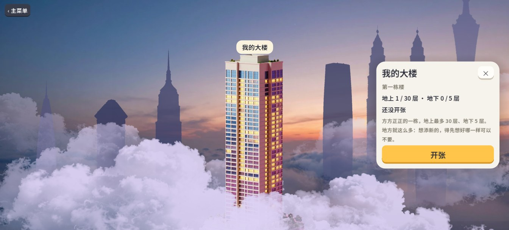
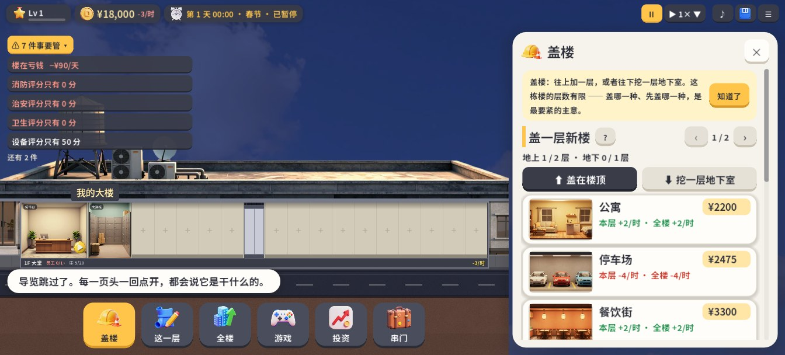

# Skyscraper Town · 摩天小镇

[中文说明](#中文)

**One tower, a whole little town.**

You own a tower. What goes up, who moves in and which shops open are all your call. Residents need food, parking and fun; shops need customers. Get the mix right and the tower makes money.

## Features

- **Each tower is a level**: every tower has its own height and shape. Space is limited, so adding something new means deciding what to give up.
- **The mix decides everything**: residents' needs must be met, shops need customers, and noisy places must stay away from homes. The same rooms can earn very differently depending on how you arrange them.
- **Over two hundred room types**: apartments, restaurants, offices, malls, gyms, schools, spas, clinics, hotels, a pet center and more.
- **More than eighty minigames**: every shop you open brings one. Chess, Go, Shogi, Mahjong, Hearts, Spades, Minesweeper, pinball, mini golf and more, each with full rules.
- **Residents with names**: everyone has a job, a mood and things they want to do, and stories grow between them over time.
- **No pressure**: no forced ads (only optional reward ads you choose to watch), fully playable without an account, and playable offline.
- **Chinese and English.**

## Download

Coming soon to Google Play. The PC version will follow.

## Guides and policies

| | |
|---|---|
| How to Play | [docs/guide.md](docs/guide.md) |
| Privacy Policy | [docs/privacy.md](docs/privacy.md) |
| Terms of Use | [docs/terms.md](docs/terms.md) |
| Delete Your Account | [docs/delete-account.md](docs/delete-account.md) |

## Feedback

Please open an [issue](https://github.com/datianda/skyscraper-town/issues) for problems or ideas.

## About this repository

This repository holds the game's guides, policies and download information only. **It does not contain source code.**

Skyscraper Town is developed by **WANWU LAB (玩物软件)**. All rights reserved. Building designs in the game are original and are not affiliated with or endorsed by any real building or its owners. The game is made with Godot Engine (MIT License) and uses the Noto Sans SC font (SIL OFL 1.1).

---

# 摩天小镇

**一栋楼，就是一座小镇。**

你是一栋楼的楼主。往上盖什么、让谁住进来、开什么店，都由你定。住户要吃饭、停车、消遣，店铺要客人：搭配得好，楼才赚钱。

## 游戏特色

- **一栋楼是一关**：每栋楼有自己的高度和形状。地方有限，想添新的就得想好哪样可以不要。
- **搭配决定成败**：住户的需求要有人接，店铺要有客源，吵的不能挨着住人的。同样的房间，摆法不同，收入能差出一大截。
- **两百多种房间**：公寓、餐饮、写字楼、商场、健身、学校、温泉、医院、酒店、宠物中心……
- **八十多个小游戏**：楼里开了什么店，就能玩什么。象棋、围棋、将棋、麻将、掼蛋、红心大战、扫雷、弹珠台、迷你高尔夫……每个都有完整的规则说明。
- **有名有姓的住户**：每个人有工作、心情和想做的事，日子久了他们之间会有故事。
- **不逼你**：没有强制广告（只有你自己点了才放的「看广告领奖励」），不注册账号也能完整地玩，不联网也能玩。
- **中文和英文**。

## 下载

即将在 Google Play 上架。电脑版随后提供。

## 说明与条款

| | |
|---|---|
| 玩法说明 | [docs/guide-zh.md](docs/guide-zh.md) |
| 隐私政策 | [docs/privacy-zh.md](docs/privacy-zh.md) |
| 用户协议 | [docs/terms-zh.md](docs/terms-zh.md) |
| 删除账号 | [docs/delete-account-zh.md](docs/delete-account-zh.md) |

## 反馈

遇到问题或者有想法，请到 [Issues](https://github.com/datianda/skyscraper-town/issues) 提交。

## 关于这个仓库

这里只放游戏的说明、条款和下载信息，**不含源代码**。

《摩天小镇》由 **玩物软件（WANWU LAB）** 开发，保留所有权利。游戏中的建筑造型均为原创设计，与任何真实建筑及其所有者没有从属或授权关系。游戏使用 Godot Engine（MIT 许可）制作，界面字体为 Noto Sans SC（SIL OFL 1.1）。
